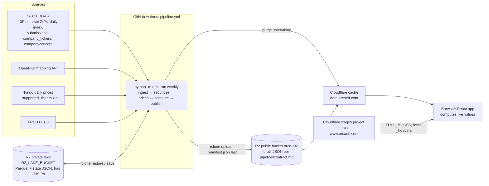

# Architecture

Last verified: 2026-11-10 (workbook section from code and the 2026-11-10 spec; pipeline facts from a full read of `pipeline/orca`; web and hosting checked in code and with curl against the live site)

## Overview

There is no API server. The "API" is the set of static JSON files defined in `pipeline/contract.md`. The browser fetches them through `web/src/data/api.ts` (one cached promise per URL) and computes value, unrealised P&L, IRR and as-of figures (`web/src/lib/live.ts`, `web/src/fund/positions.ts`).

## Pipeline (`pipeline/orca`)

| Module | Purpose |
|---|---|
| `config.py` | thresholds (top lists, conviction, calls), `PERIODS`, `VALUE_DOLLARS_FROM`, lake/out dirs |
| `http.py` | `Client` (rate limit, retries), `FetchError`, `sec_client`, `figi_client`, `tiingo_client`, `fred_client` |
| `sec/bulk.py` | list and parse SEC 13F data-set ZIPs (`list_bulk_zips`, `parse_bulk_zip`, `raw_holdings`, `value_to_usd`) |
| `sec/live.py` | EDGAR daily index + submission `.txt` parsing (`fetch_new_filings`, `parse_daily_index`) |
| `holdings.py` | `select_reports`, `build_holdings`, `fill_gaps` |
| `securities.py` | CUSIP → FIGI/ticker (`map_cusips`), stock ids, SIC → sector, SEC lookups |
| `vendor.py` | Tiingo ticker universe (`load_universe`, `resolve`, `candidates`) |
| `prices.py` | `TiingoSource`, incremental price store, compaction, split adjustment |
| `quarter_px.py` | quarter VWAP/low/high/close/dividends (`quarter_px`, `last_close_before`) |
| `rf.py` | FRED DTB3 yearly average (`fetch_tbill`) |
| `storage.py` | `Lake` (zstd Parquet, atomic writes), `Manifest` |
| `engine/position.py`, `engine/fund.py`, `engine/metrics.py`, `engine/whatif.py` | average-cost P&L, fund quarters/years/contributions, performance metrics, exits |
| `home.py` | home lists (`top_funds`, `conviction_moves`, `wins_losses`, `just_filed`, `crowded_buys`, `calls`) |
| `publish.py` | JSON + brotli writers, manifest, health |
| `workbook/` | the per-fund Excel workbook builder (see Workbook below) |
| `run/` | `cli.py` (argparse), `weekly.py` (`run_weekly`, `run_home`, `verify`), `workbook.py` (`build_workbooks`), `ingest.py`, `market.py`, `compute.py`, `publish_step.py`, `state.py`, `budget.py`, `sources.py`, `preflight.py` |
| `demo.py` | synthetic offline dataset for `web/public/demo-data` |

CLI: `python -m orca.run {weekly | rebuild | home | check-keys | verify [--sample N --seed S] | workbook --fund ID [--fund ID …] [--out DIR --max-positions N] | demo [--out --plain --seed]}`. Demo data: `uv run python -m orca.run demo --plain --out ../web/public/demo-data` (from the pipeline plan; `DEMO_TODAY` 2026-10-30, 12 funds).

Env var names read by code: `ORCA_CONTACT`, `OPENFIGI_KEY`, `TIINGO_KEY`, `TIINGO_RATE_PER_SEC`, `FRED_KEY`, `ORCA_TIME_BUDGET_MIN`, `ORCA_LAKE_DIR` (default `data/lake`), `ORCA_OUT_DIR` (default `data/out`), `ORCA_NETWORK` (tests).

### Ingestion
| Item | Fact |
|---|---|
| Schedule | `pipeline.yml`: `23 6 16 * *` (the job is named `weekly` but runs monthly), `41 7 1 * *` runs `verify`; both need `vars.ORCA_SCHEDULE_ENABLED == 'true'`; manual inputs `full`, `home_only`; concurrency group `pipeline` |
| Prices | daily bars from each stock's last stored date to today (`prices.TiingoSource`, `startDate`/`endDate`); targets: latest-quarter holdings, SPY, exits within `EXIT_REFRESH_QUARTERS = 6`, never-fetched stocks; stalest first (`run/market.refresh_prices`) |
| Timeouts | job 330 min, step 300 min; budget `ORCA_TIME_BUDGET_MIN` (default 270, `run/budget.py`); the price stage stops with `min(90, budget/3)` min left (`run/market.py` `PRICES_RESERVE_MIN`) |
| SEC | `SEC_RATE_PER_SEC = 8.0` (`http.py`); User-Agent `Orca research {ORCA_CONTACT}`, `RuntimeError` if unset |
| Others | OpenFIGI keyed 25 req/6 s × 100 jobs (anonymous 25/60 s × 10); Tiingo 2.5/s default; FRED 2/s; timeout 30 s |
| Retries | up to 4, sleeping 2/4/8/16 s, on transport errors, 429 and 5xx; other 4xx and all 3xx raise (no redirects) (`Client._request`) |
| Breakers | prices stop on 401/403/429 or 25 consecutive failures (`prices.py`); live ingest stops after 3 refused days/downloads or a 429 (`live.py`) |
| Idempotency | `ingested.json` (ZIP name → sha256; the skip check is by name only); per-quarter parts replaced by (accession, source); `state.json` pending sets are cleared only after a successful publish; `_reconcile_published` compares `published.json` with the site manifest; only changed files upload; `manifest.json` last |
| Failures | `health.json` flags (e.g. `fetch_failed`, `live_failed`, `cusip_mapping_failed`, `prices`, `tbill_failed`, `time_budget`, `price_mismatch`, `split_suspect`), at most 100 per kind; `InvariantError` / `CusipLeakError` / `HealthGateError` abort before the manifest; the lake is saved after any run. Health gates (`run/gates.check_health`, called in `run_weekly` after the CUSIP scan): lake has CUSIPs but none mapped to a stock; median `priced_pct` below `config.COVERAGE_MIN` = 0.90 (live 0.988); funds with reports were tried and none was computed (`_Funds.with_reports`; funds without a report are not counted, and not when the time budget cut the run). `run_home` is not gated |
| verify | rebuilds 50 random published funds from raw parts and compares sha256 with `published.json`; no API calls |

### 13F quirks handled
| Quirk | Handling (file, function) |
|---|---|
| Amendments | base = latest 13F-HR, or the latest RESTATEMENT; NEW HOLDINGS amendments filed after it are added and summed; unknown types ignored; bulk beats live for the same accession (`holdings.select_reports`, `_bulk_first_unique`) |
| Value units | VALUE × 1000 for filings before 2023-01-03, dollars from then (`config.VALUE_DOLLARS_FROM`, `bulk._unit_multiplier`); valuation uses shares × our price, VALUE only as a fallback price |
| CUSIP mapping | OpenFIGI (prefer `exchCode == "US"`, composite FIGI), else exact name match to one SEC ticker; ETF when `securityType == "ETP"`; retried/remapped every 28 days (≤ 2000 per run); vendor tickers resolved from Tiingo's list (`securities.map_cusips`, `vendor.candidates`) |
| Options, bonds | PUT/CALL and PRN rows are stored but only `kind == "SH"` enters P&L and pricing (`run/compute.py`); their value still counts in `priced_pct` |
| Filing lag | latest quarter = quarter whose 45-day deadline has passed (`weekly.deadline_quarter`, `DEADLINE_DAYS = 45`) |
| Missed quarters | one missed quarter is carried (`carried=True`); a gap of 2+ starts a new segment and only the last segment is computed; `inactive` when the last filing is older than `last_q − 1` (`holdings.fill_gaps`, `compute_fund`) |
| Splits | prices split-adjusted, share counts adjusted by quarter factors; suspicious 2/3/4/5/10× changes flagged (`prices.split_adjust_prices`, `compute.split_suspects`) |
| Unpriced | a held unpriced stock enters the book at its first priced close; fallback chain last close → implied price; > 10× mismatch flagged (`engine/position.compute_position`) |
| Duplicates | SUBMISSION/COVERPAGE de-duplicated by accession; share classes summed per `stock_id` |
| Confidential treatment | UNKNOWN / not handled in code |
| Notice filings | 13F-NT / 13F-NT/A carry no holdings and are skipped (`sec/bulk.KEPT_FORMS`); a fund that only filed a notice shows its previous quarter (Pershing Square Q2 2026) (code)(chat) |
| Value in thousands after 2023 | some filers kept reporting thousands; ~1,000 `price_mismatch` flags, often exactly 1000× (chat) |
| Invalid CUSIPs | ~29,000 filing CUSIPs (often a dropped leading zero) get an OpenFIGI error → method "error", no name match, left out (`securities.py`) (code)(chat) |
| Delisted stocks | OpenFIGI drops the US ticker and returns a foreign listing (`XLNXEUR`, `TWTRUSD`); repaired by stripping `vendor.CURRENCY_SUFFIXES` (code) |
| Reused tickers | a vendor ticker counts only over dates overlapping the stock's held span (`vendor.resolve`; `FB` today is not Facebook) (code) |
| Holding companies and corporates | single-stock vehicles jump 0 → 96%+; filers like Alphabet Inc. report huge new stakes; book jumps from newly priced holdings or restructurings (Woodbridge $737M → $25.2bn). Conviction skips largest holding > 33% and AUM change outside ½–2× (code `home._conviction_quarter`)(chat) |
| Share-count errors | some BRK-A share counts were off 15–28× (chat) |
| Spin-offs, in-kind transfers | shares received in a spin-off or moved in kind by a wealth-management client look like trades; not separable in 13F data (chat) |

### Home lists and conviction (code)
- Each fund snapshot (`home.FundSnapshot`) carries `conviction_quarters`: `ConvictionQuarter` records for its last 8 quarters (`q, start, end, top_prev, n_held, filed_pair, moves[(stock_id, kind, usd, w_prev, w_after, px)], flow`), built by `run/compute._conviction_quarters`. A move under `CONVICTION_KEEP` (1% of the smaller of start and end AUM) is not stored.
- `home.conviction_moves` applies the thresholds at publish: `_conviction_quarter` (eligibility), `_usual_move` (biggest move of the 4 quarters before), `_move_size` (buys ÷ end AUM, sales ÷ start AUM; adds/trims minus `flow × w_prev`, clipped). ETFs = `securities.is_etf` or `sector == ETF_SECTOR` (`run/publish_step.py`).
- `python -m orca.run home` (`run/weekly.run_home`) rebuilds `funds.json`, `securities.json`, `latest_prices.json` and `home/*.json` from stored `fund_state` with no fetch or recompute; it refuses when the deadline quarter moved or work is owed. Pipeline input `home_only` runs it (~5 min vs ~2 h rebuild, chat).

### Workflow resilience (code `.github/workflows/pipeline.yml`, `.github/actions/*`)
| Guard | Why (chat) |
|---|---|
| rclone install variables named `ORCA_RCLONE_*` | rclone reads every `RCLONE_*` env var as an option (run 1 failed) |
| Secrets stripped of whitespace; malformed R2 key id named; Cloudflare account id = the 32-hex part of whatever was pasted; Pages project created if missing (`web.yml`) | runs 2–4 and the first deploys failed on pasted secrets |
| `check-keys` step (`run/preflight.py`) before the restore | a bad OpenFIGI/Tiingo/FRED key otherwise fails an hour in |
| Manifest restored with `copyto --ignore-size --ignore-checksum`; reader accepts plain JSON | R2 hands brotli files back decoded (run 6) |
| `RCLONE_TIMEOUT=60s`, `RCLONE_CONTIMEOUT=15s`, stats every 30 s; restore retried 3× under `timeout 15m` | a 41-min silent restore stall |
| Upload 64 at a time with `--s3-no-head` | the first full upload took ~75 min |
| `echo 1000 > /proc/self/oom_score_adj`; memory/disk logged every 60 s | an out-of-memory runner loses the save step with it |
| Save step kills a leftover `orca.run` (TERM, then KILL after 30 s) and runs only if the restore succeeded | a cancelled run kept writing the lake during the save |
| `_recompute_set` scans CIKs only; `latest_closes` reads the last `LATEST_CLOSE_WINDOW_DAYS = 14` days of bars per stock | both loaded whole tables and killed the 8 GB runner (runs 9–12) |

Run size (chat, 2026-11-02): 13,314 funds, 74,358 files on a full publish, ~80 min, memory peak ~4.5 GB of the public repo's 16 GB / 4-core runner; restores 15–64 s; fund compute ~48 min on one core.

### Engine formulas
| Figure | Formula (function) |
|---|---|
| Quarter return | `(end − start − net_buying + dividends) / (start + net_buying/2)`; None for a segment's first quarter or a non-positive start/denominator (`fund.aggregate_fund`) |
| Bridge | `end = start + market_move + net_buying + trade_gains`, tolerance 1e-6 × max(1, \|end\|, \|start\|, buys+sells) (`check_bridge`) |
| Year | `∏(1+r) − 1`; `approx_ret = (gains + dividends) / (start + inflows/2)` (`fund_years`) |
| Metrics | ann = growth^(4/n) − 1; vol = stdev × 2; Sharpe = mean(excess)×4 / (stdev(excess)×2); Sortino = mean(excess)×4 / (sqrt(mean(min(0,x)²))×2); Calmar = ann/\|max_dd\|; rf per quarter = year's DTB3 mean / 4; needs ≥ 4 returns (`metrics.performance`) |
| Turnover, hold | mean over full years of min(buys, sells) / mean book; hold = quarters held / 4 (`metrics.turnover`, `hold_lengths`) |
| Trade price | first report: close; else quarter VWAP of (H+L+C)/3; else last close; else implied (`position._trade_price`, `quarter_px.quarter_px`) |
| Avg cost, realised | buy adds delta×px; sell realises −delta×(px − cost/shares) (`compute_position`) |
| Contribution | pnl / (year start + inflows/2) × 100 (`fund.contributions`) |
| Conviction | score = size / max(usual, 0.01) (`home.conviction_moves`) |
| Exits | one_y = close(q+4)/last sale px − 1; spy_one_y = SPY close(q+4)/SPY VWAP(q) − 1 (`whatif.exit_rows`) |

## Lake schema (zstd Parquet, `storage.Lake.write`)
| Table | Columns (units) |
|---|---|
| `filings/qNNN`, `reports/qNNN` | accession, cik i64, period i16 (quarter index), filed date, form, amendment_type, manager_name, source (bulk/live) |
| `raw_holdings/qNNN` | accession, cusip, issuer, title, shares f64, sh_type, put_call, value_usd f64 (dollars), source |
| `holdings/qNNN` | cik, q i16, cusip, kind (SH/PRN/PUT/CALL), shares, value_usd, filed |
| `securities` | stock_id i32, figi, ticker, name, is_etf, cik, sic i32, sector, shares_out |
| `cusip_map` | cusip, stock_id, method, tried (internal only, never published) |
| `prices_daily/{y<year>, z<run>-NNNN}` | raw unadjusted OHLC f32, volume f64, split_factor f32, dividend f32 |
| `vendor_tickers` | stock_id, ticker, end |
| `rf` | year i32, rate f64 (decimal) |
| `fund_state`, `fund_state_run/bNNNNN` | cik, meta JSON, snap JSON |
| JSON | `ingested.json`, `state.json` (watermarks, pending sets, `last_q`, `rf_stale`), `published.json` |

### Lake backups (`pipeline.yml`, step "Back up the lake state")
- After a scheduled run that succeeded end to end (pipeline and save; never a manual run, so reruns cannot flush the good monthly backups), `rclone copy` puts the small, hard-to-rebuild lake state in `backups/<UTC date>/` of the PRIVATE lake bucket: `ingested.json`, `state.json`, `published.json`, `fund_state`, `cusip_map`, `vendor_tickers`, `securities`, `rf`. Not `prices_daily` (large; refetched from Tiingo) and not `filings`/`raw_holdings`/`holdings`/`reports` (rebuilt from the SEC's files). The source is the local lake just saved, not a server-side copy (no overlap with the live keys).
- Then the 3 newest folders named exactly `YYYY-MM-DD/` are kept and older ones removed with `rclone purge`; nothing is removed unless today's folder is listed. Anything else under `backups/` is never touched.
- `restore-r2` and the save both `--exclude "backups/**"`, like `workbooks/**`: backups are never restored into a run and the save's `sync` never deletes them.
- The step is the last one, with a 10-minute timeout. A failed copy removes today's partial folder, prints `::error::` and fails the run (red run, and the `alert` job opens an issue); the site and lake are already published and saved by then. Restore drill: `docs/domain-and-data-hosting.md`, "Restore from backup".

Published files: `fund/{id}/{summary,positions,contrib,exits}.json` (`publish.publish_fund`); `funds.json`, `securities.json`, `latest_prices.json`, `home/*.json` (`publish.publish_shared`); `stock/{id}/weekly.json` (`publish.publish_weekly`); `health.json`, `manifest.json`. They are minified with sorted keys and brotli quality 9, uploaded with `Content-Encoding: br` and `Cache-Control: public, max-age=300`, which the Cloudflare cache rule overrides. CUSIP guard: `_json_ready` refuses a `cusip` key and `publish_step.cusip_leaks` scans the staged files. Field meanings and units: `pipeline/contract.md`.

### Workbook (`pipeline/orca/workbook/`, phase 1: owner-only)
- Modules:
  - `inputs.py`: `FundInputs`, taken from exactly what the engine used (`run.compute.Prepared` and `FundResult`); `validate`, `to_json` / `from_json` (brotli JSON, no CUSIP ever).
  - `cut.py`: funds over 500 positions keep the top 500 by peak value; the rest become one "All other positions" line.
  - `layout.py`: the block and column registry; `model.py`, `outputs.py`, `summary.py`: the three tabs (xlsxwriter, constant memory); `sheet.py`: fast writer and formats; `build.py`: `build_workbook`, `file_name`; `parity.py`: site-versus-Excel test support.
- CLI: `python -m orca.run workbook --fund ID [--fund ID …]` (`run/workbook.py`). It reads the lake like `verify`, then per fund validates the inputs, checks `from_json(to_json(fi)) == fi`, and writes `<out>/inputs/<id>.json` and `<out>/orca-<id>-<name>-<price date>.xlsx`. Unknown fund: `fund N: not found`, exit 1. No priced positions: skipped, exit 0. Output lines carry only ids, sizes and timings.
- Action `.github/workflows/workbook.yml` (manual, `fund_ids`, at most 20 numeric ids on one line, checked in a step that refuses control characters and passes only the validated list on): restores the lake (`production` environment, `concurrency: pipeline`), builds, and copies `pipeline/data/workbooks` to the PRIVATE lake bucket under `workbooks/manual/<UTC date>/`. It never saves the lake and uploads no artifact (the repository is public). The upload step runs even when a fund failed (`!cancelled()` and some file built), so the funds that built are stored while the job stays red through the failed build step.
- A fund that fails for any reason (unknown, invalid inputs, any other exception) prints `fund N: ...` (the exception type only), leaves no file (workbook built to `.part` and renamed, inputs file written last, partial files removed), and the other funds still build; the command exits 1.
- The lake sync in `restore-r2` and the save in `pipeline.yml` both `--exclude "workbooks/**"` and `--exclude "backups/**"` (see Lake backups below): past workbooks are not restored (no run reads them), and the save would otherwise delete them from the bucket.
- Private paths: `workbooks/manual/<date>/` in the lake bucket only. Nothing is public, so `pipeline/contract.md` is unchanged.
- Design: workbooks are built on demand, never pre-built (a monthly pre-build was estimated at ~2.5 h on four cores). GitHub Actions are only for this owner-only phase.
- Phase 2 (own spec, not built): the monthly run writes small private input files for every fund; a Worker checks payment; a Cloudflare Container builds the file. Needs login and payments, and Tiingo's redistribution licence.
- Tests: LibreOffice recalculates the files (`tests/lo.py`); CI installs it and sets `ORCA_REQUIRE_LIBREOFFICE=1`, so a missing `soffice` fails there instead of skipping. Excel itself has not been run.

## Web (`web/`)
- Routes (`web/src/App.tsx`): `/`, `/fund/:id`, `/fund/:id/stock/:stockId`, `*` (`/how-it-works` was removed 2026-11-11).
- Data: `VITE_DATA_URL` (build-time; default `/demo-data`). The fund page loads `funds.json` (to tell an unknown fund from a failed load, R29), `securities.json`, `latest_prices.json` and the fund's 4 files. `weekly.json` files load lazily: on demand when a period or row needs them, and prefetched in the background after landing (`web/src/fund/prefetch.ts`).
- Row budget for big tables: `web/src/fund/loading.ts` (50 / 200 / 25 / 100).
- Build: `vite build`, then `scripts/prerender.mjs`. Prerender writes `dist/fund/{id}/index.html` for the `PRERENDER_MAX` (15,000) largest funds and `dist/_headers`. With `SITE_URL` (PR #3, merged a2a1554) it also writes `sitemap.xml`, `robots.txt` and canonical links. With an absolute `VITE_DATA_URL` (PR #3) it removes `dist/demo-data`.

## Cloudflare setup
| Service | Setting |
|---|---|
| Pages project `orca` | deployed by `wrangler pages deploy dist --project-name ${CF_PAGES_PROJECT:-orca} --branch main` (`.github/workflows/web.yml`); default address `orca-88p.pages.dev`; custom domains `www.orcaetf.com`, `orcaetf.com`; no Functions/Workers, no bindings |
| Redirect rule | `orcaetf.com/*` → `https://www.orcaetf.com/${1}` 301 (dashboard) |
| R2 `orca-site` | public; custom domain `data.orcaetf.com`; CORS GET/HEAD for www, bare, pages.dev, localhost:5173 (set in dashboard); `r2.dev` address still enabled |
| Cache rule | host `data.orcaetf.com`: eligible, edge TTL 1 month, browser TTL 2 hours (dashboard) |
| DNS | DNSSEC on; SPF `v=spf1 -all`; DMARC `p=reject` (verified via DoH) |
| R2 lake bucket | private (`R2_LAKE_BUCKET`) |

GitHub secrets (names): `R2_ACCESS_KEY_ID`, `R2_SECRET_ACCESS_KEY`, `R2_ENDPOINT`, `ORCA_CONTACT`, `OPENFIGI_KEY`, `TIINGO_KEY`, `FRED_KEY`, `CLOUDFLARE_API_TOKEN`, `CLOUDFLARE_ACCOUNT_ID`, `CF_PURGE_TOKEN`. Variables: `R2_LAKE_BUCKET`, `R2_SITE_BUCKET`, `ORCA_SCHEDULE_ENABLED`, `ORCA_TIME_BUDGET_MIN`, `TIINGO_RATE_PER_SEC`, `VITE_DATA_URL`, `SITE_ORIGINS`, `CF_ZONE_ID`, `CF_PAGES_PROJECT`, `SITE_URL`, `HSTS_MAX_AGE`. The deploy and pipeline jobs run in the `production` environment.

Deploy: a push to `main` touching `web/**` runs `web.yml`. The test job (vitest, demo build, Playwright) runs first. Then the deploy job fetches `funds.json` from `VITE_DATA_URL`, builds with `PRERENDER_FUNDS`, `SITE_URL` and `HSTS_MAX_AGE`, and runs wrangler. PRs run tests only.

## Tech debt and risks
- Confidential-treatment 13F filings are not handled (code).
- Only the latest tracking segment is computed, so history before a gap of 2+ quarters is dropped (code).
- The bulk ZIP skip ignores the checksum; there is no `is_finite` check on VALUE (code).
- Golden snapshots were never committed (`pipeline/tests/golden/` holds only `.gitkeep`) (code).
- Deferred review items: the weights ≈ 100% invariant is unchecked; a crash window between `write_manifest` and the `fund_state` writes; a `pending_all` run doesn't republish every weekly file (rulings doc).
- The Site CORS workflow lacks an R2 Admin token; the purge clears the whole zone (chat).
- A big fund fetches ~2,000+ `weekly.json` files when stepping back a quarter before the prefetch is done (about 7 s measured). A per-fund quarter-end price file would fix that (chat).
- The fund Positions and What-if tables, and every Home table, are plain `<table>`s with all loaded rows: layout cost grows with rows; capped by `loading.ts` (fund tables) and not virtualised. `DataTable` has a `virtual` mode (`@tanstack/react-virtual`), but no caller turns it on (code).
- No server-side gating is possible while all data is public (chat).
- Fund compute runs on one core (~48 min); parallel compute was estimated at 17–20 min, not built (chat)(code).
- `home/just_filed.json` is built and published with no reader since 2026-11-06 (code).
- `.trunc` and `.two-line` in `web/src/styles.css` have no users since PR #1 (code).
- A hard cap on files uploaded per run was offered (2026-11-01) and not built (chat)(code).
- Conviction cannot tell spin-off receipts or in-kind client transfers from trades (chat).
